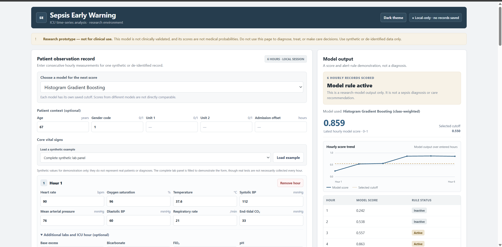

# Early Sepsis Warning from ICU Time Series

A reproducible research project using the PhysioNet/Computing in Cardiology Challenge 2019 training data. The goal is to estimate whether a patient's current hourly record falls in the dataset's sepsis-positive window, using only that hour and earlier measurements.

> **Research prototype only — not for clinical use.** This project has not been clinically validated. Its scores are model outputs, not medical probabilities. Do not use it to diagnose, treat, triage, or make care decisions. Use synthetic data for the demo; never enter identifiable patient information.

## Dataset and label

Download the open-access Challenge 2019 files from [PhysioNet](https://physionet.org/content/challenge-2019/1.0.0/). The included downloader uses the public PhysioNet S3 mirror and Python's standard library:

```bash
python -m src.download_data --output-dir data/raw
```

The loader searches subfolders recursively. Follow the dataset citation and license terms on the PhysioNet page. Do not commit patient data.

Each row is an hourly observation and `SepsisLabel` is the challenge target. The challenge shifts positive labels to begin six hours before the clinical onset time and keeps them positive afterward. The intended task is early detection using current and past data. Because labels also stay positive after onset, row-level classification metrics alone can hide late alerts; the project therefore includes patient-level alert-timing and false-alarm analysis. This remains a research prototype, not a clinical tool.

## Quick start

```bash
python -m venv .venv
# Windows PowerShell: .venv\Scripts\Activate.ps1
# macOS/Linux: source .venv/bin/activate
python -m pip install -r requirements.txt
python -m src.download_data --output-dir data/raw
python -m src.run_pipeline --data-dir data/raw --output-dir outputs
python -m src.analyze_alerts --output-dir outputs
```

The pipeline creates patient-level train/validation/test partitions and causal rolling features. It compares class-weighted Logistic Regression and Histogram Gradient Boosting at utility-selected thresholds with unweighted versions whose thresholds are selected for validation accuracy. It writes metrics, test predictions, and a reusable `trained_models.joblib` bundle containing all fitted models, selected thresholds, and the feature schema. The alert-analysis step adds patient-level coverage/false-alarm summaries and a results report.

To generate hourly risk scores for one patient file using the saved model:

```bash
python -m src.predict --input data/raw/training_setA/p000002.psv --model hist_gradient_boosting
```

This produces `outputs/patient_risk_predictions.csv`. The included example is for demonstrating the pipeline only; predictions are not for clinical use.

## Local web demo

The project includes a small Python HTTP backend and browser interface for entering hourly records manually or importing a PhysioNet-style `.csv`/`.psv` file. The page lets you choose among three trained models: the current LightGBM pipeline, class-weighted Logistic Regression, and class-weighted Histogram Gradient Boosting. LightGBM is selected by default. Each model uses its own saved features and cutoff; scores from different models are not directly comparable and are not clinical probabilities. The app loads `outputs/improved/improved_model.joblib` and `outputs/trained_models.joblib` at startup.



### Run the demo

The included model bundles are enough to launch the demo; downloading the PhysioNet dataset is only needed to retrain or reproduce the experiments.

**Windows PowerShell** (run these commands from the folder where you want the repository):

```powershell
git clone https://github.com/abhinavvgoell/sepsis-early-warning-demo.git
Set-Location sepsis-early-warning-demo
py -m venv .venv
.\.venv\Scripts\python.exe -m pip install -r requirements.txt
.\.venv\Scripts\python.exe -m src.app
```

**macOS/Linux:**

```bash
git clone https://github.com/abhinavvgoell/sepsis-early-warning-demo.git
cd sepsis-early-warning-demo
python3 -m venv .venv
.venv/bin/python -m pip install -r requirements.txt
.venv/bin/python -m src.app
```

Keep that terminal open, then visit [http://127.0.0.1:8766](http://127.0.0.1:8766). Stop the local server with `Ctrl+C` in the terminal.

The demo includes synthetic example profiles, per-hour model explanations where supported (LightGBM TreeSHAP contributions and Logistic Regression additive contributions), a reset button, input checks, and a downloadable CSV report. The Histogram Gradient Boosting model does not currently provide a per-record explanation in this interface. Explanation directions describe model contributions, not clinical causes. Blank measurements are allowed; out-of-range values are checked against broad software sanity bounds, not medical limits. The CSV report is generated in the browser only when the user downloads it.

To retrain and reproduce the LightGBM experiment, first download the PhysioNet data, then run (this includes grouped CV and can take a while):

```bash
python -m src.improved_pipeline --data-dir data/raw --output-dir outputs/improved --cache-dir outputs/improved/cache
```

Only the two model bundles used by the current demo are included. Other experimental model bundles and generated prediction tables are excluded; they can be reproduced from the scripts and downloaded dataset.

The server binds to localhost, processes records in memory, and does not save them. The displayed scores and alert policy are research outputs, not for clinical care.

This is a single-user local classroom demo, not a deployed clinical service. It has no login or account system because it does not retain records or serve multiple users. Do not expose the server to a network or enter real patient information. The in-browser CSV export contains the entered values and model outputs; save and share it only as synthetic or appropriately de-identified demo material.

Keep the Python process running while using the page. If the browser says “Failed to fetch,” the backend is usually stopped; run `python -m src.app` again from the project directory and refresh the page.

## Evaluation design

- Patients, never rows, are assigned to separate splits to prevent patient leakage.
- Patient-level folds are used for out-of-fold alert-policy selection. A five-fold summary is reported for the improved candidate. The project test split has been examined during earlier experiments, so test results are exploratory rather than a final unbiased estimate.
- Features use current and past values only. Rolling means and observation counts are shifted so the current hour is excluded from historical summaries.
- Report PR-AUC, ROC-AUC, sensitivity, specificity, precision, F1, and confusion counts. Because labels are imbalanced, accuracy is not a primary metric. Add patient-level alert timing/false-alarm analysis against the challenge's utility framing.
- The isotonic calibrator is fitted to the pooled out-of-fold predictions and its in-sample calibration score is optimistic. The test evaluation offers a separate check for that fit, but the repeated use of this split still limits claims.
- Keep an eye on calibration and false alarms per patient. Aggregate row-level scores do not establish clinical utility.

## Project stages

1. Data audit and label/measurement checks.
2. Patient-level split and causal feature generation.
3. Baseline and model comparison.
4. Threshold selection on validation data and one-time test evaluation.
5. Error analysis, limitations, and a concise results report.

## Reproducibility

Random seeds are fixed in the pipeline. The data is not bundled; users must download it from PhysioNet. Record the downloaded dataset version and cite the challenge paper when sharing results.

When sharing the project, include the source, reports, requirements, and chosen model bundle. Leave out `.venv*`, `data/`, cached features, and row-level prediction exports; the dataset should be downloaded from PhysioNet under its terms.

## Results and reports

See [final_project_report.md](outputs/final_project_report.md) for the project summary, current candidate, metric comparison, evaluation caveats, limitations, and reproduction details. The LightGBM candidate is supported by internal grouped cross-validation, but its test comparison is exploratory and not a final unbiased estimate.

See [initial_results.md](outputs/initial_results.md) for the current patient-held-out comparison and patient-level alert review. These are initial project results, not clinical performance claims.

See [alert_policy_results.md](outputs/alert_policy_results.md) for a comparison of immediate, persistence-based, and cooldown alert rules. The 2-of-3-hour persistence rule had the highest timing-aware utility in that sweep; the 3-of-5-hour rule reduced the share of non-sepsis patients receiving any alert further, with a modest drop in timely sepsis-window coverage. The comparison is exploratory because the same held-out patients have been examined before.

See [alert_policy_grid_results.md](outputs/alert_policy_grid_results.md) for the broader comparison of all 36 k-of-n alert rules from 1 to 8 hours. In that exploratory sweep, 1-of-5 had the highest observed timing-aware utility; 4-of-7 had a lower patient-level false-alert rate, with lower coverage and utility. The full results are in `outputs/policy_grid/alert_policy_grid.csv`.

See [trend_feature_results.md](outputs/trend_experiment/trend_feature_results.md) for the causal vital-sign trend feature experiment. It added prior-reading changes and six-hour variability features, then compared three boosted-tree settings at a matched validation false-alert rate. The selected candidate's held-out PR-AUC improved, while held-out timing-aware utility was slightly lower; the original model remains the headline model pending a fresh evaluation.

See [generalization_results.md](outputs/generalization_experiment/generalization_results.md) for the train-versus-validation gap, a regularized Random Forest comparison, and blends of the original and trend boosted trees. The regularized trend model led on validation utility; the blend had slightly higher validation PR-AUC. No test data was used in this comparison.

See [last_observation_results.md](outputs/last_observation_experiment/last_observation_results.md) for the latest causal last-value/freshness features and three-fold patient-grouped comparison. It reports the trade-off and larger train/validation gap; this experiment did not use the held-out test split.

See [improved_results.md](outputs/improved/improved_results.md) for the LightGBM feature/model changes, five-fold results, alert-policy trade-offs, test comparison, bootstrap interval, and limitations. The selected demo policy is the 1-of-5 rule; the utility-optimal 1-of-2 policy produces more patient false alerts.

The accuracy-oriented models reach the majority-class baseline accuracy but detect no positive hours at their selected cutoffs. They demonstrate why accuracy alone is not an appropriate success target for this imbalanced early-warning problem. Any future final evaluation should use a new untouched test set or external data.
